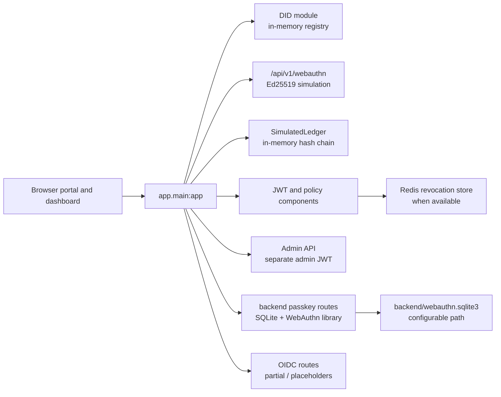

# TrustMesh — Decentralized Zero-Trust Identity Provider Mesh

TrustMesh is an educational FastAPI prototype that combines DID records, passkey-related authentication flows, Ed25519 cryptography, JWT verification, a zero-trust policy component, token-revocation storage, an administrative API, and a browser dashboard. The repository contains multiple implementations of some of these components; they are not yet one production-ready identity platform.

> **Current status:** The main FastAPI application is runnable, but several end-to-end integrations are incomplete. In particular, browser passkey login does not create an application JWT or admin session, ordinary JWT issuance and self-service revocation return `503`, OIDC exchange endpoints are placeholders, and the ledger is a single-process hash-linked simulation—not a distributed blockchain or consensus network.

## Problem and objectives

Traditional identity services can concentrate identity and authorization decisions in one provider. TrustMesh explores how public-key identities, explicit verification, and state-aware policy checks could reduce implicit trust. The academic prototype aims to:

- Represent identities as DID documents associated with Ed25519 public keys.
- Demonstrate challenge-based possession checks and passkey registration/login.
- Anchor identity lifecycle events in a tamper-evident SHA-256 hash chain.
- Implement JWT signing/verification and policy evaluation components.
- Persist token revocations in Redis when configured with verifiable durability settings.
- Expose health, ledger, identity, token, and admin interfaces for evaluation.

These are project objectives, not a claim that every feature is fully integrated or production ready. See [Implementation status](docs/IMPLEMENTATION_STATUS.md) for what each code path currently does.

## Features in the current source

- **DID module:** creates `did:mesh:key:<16-hex-character-id>` identities, stores DID documents in an in-process registry, supports reads and controller-authorized updates/deactivation, and can anchor lifecycle records.
- **Two passkey paths:** the `/api/v1/webauthn` module is an Ed25519 challenge-response simulation; the browser portal uses the separate `backend.main` WebAuthn library flow and SQLite storage. They do not share credential or DID storage.
- **Ledger:** one process-local, append-only SHA-256-linked record chain with integrity verification and optional JSON persistence in the class. The application singleton does not configure file persistence.
- **JWT components:** EdDSA/Ed25519 issue and verify code, public-key and scope endpoints, and fail-closed verification against revocation state. The HTTP issue/revoke operations are currently disabled.
- **Admin API:** routes require a separately issued admin JWT, a configured allowlisted DID, the `admin:ledger` scope, and Redis durability checks.
- **Dashboard and portal:** framework-free static pages served by FastAPI; the dashboard displays public ledger/token/health data, while the login page calls the alternate browser WebAuthn implementation.
- **OIDC:** static discovery metadata and request-shape checks exist; authorization, token exchange, and userinfo are not a functioning OIDC provider.

## Architecture at a glance



The two identity/passkey implementations and the in-memory ledger are not a shared, durable, multi-node identity network. See [Architecture](docs/ARCHITECTURE.md) for data boundaries and verified flows.

## Technology stack

- Python 3.10+ syntax; FastAPI, Uvicorn, Pydantic 2
- `cryptography` Ed25519, PyJWT EdDSA, `webauthn` library
- Redis for shared token revocation state; SQLite for the browser passkey path
- HTML, CSS, and vanilla JavaScript; no Node.js build step or frontend framework
- pytest/httpx tests are present in `tests/` and `core_security_tests/`

There is no `pyproject.toml`, Node package manifest, or license file in the repository. Python 3.10 is a syntax-based minimum, not a published/tested support matrix.

## Repository map

```text
app/
  main.py                    Combined FastAPI application and router/static wiring
  core_security/             Separate process-local DID/challenge/ledger core
  modules/
    admin/                   Admin API, models, and admin JWT authorization
    did/                     DID API and schemas
    identity/                DID and Ed25519 services
    ledger/                  Simulated hash chain, models, router, hashing
    tokens/                  JWT engine, policy, revocation, models, router
    webauthn/                Simulated Ed25519 credential/challenge flow
backend/
  main.py                    Separate browser-WebAuthn FastAPI entry point;
                             its passkey router is also mounted by app.main
  oidc/                      Discovery and incomplete OIDC route/service code
  storage.py                 SQLite helper used by a separate backend service module
frontend/
  index.html, login.html     Portal pages
  webauthn.js                Browser WebAuthn client
  dashboard/                 Static dashboard HTML, CSS, JavaScript
docs/                        Current guides plus supplemental/historical module notes
tests/                       Unit, integration, and security tests
core_security_tests/         Tests for the separate core_security package
requirements.txt             Main application and test dependencies
```

`backend.main:app`, `app.main:app`, and `app.core_security` are distinct code surfaces. The primary combined application is `app.main:app`.

## Installation and running

Use the [Installation Guide](docs/INSTALLATION_GUIDE.md) for the complete setup and troubleshooting instructions. In brief:

1. Use Python 3.10 or newer and Git. Redis is required for durable revocation and admin authentication. Node.js is not required.
2. Create and activate a virtual environment, then install the root requirements:

   ```powershell
   python -m venv .venv
   .venv\Scripts\Activate.ps1
   pip install -r requirements.txt
   ```

3. Before importing the primary app, set `TOKEN_KEY_DIR` to an existing protected directory **outside this repository**, containing the matching files `token_signing_private.pem` and `token_signing_public.pem`. The app does not generate or replace them.
4. Configure Redis and run the primary ASGI app:

   ```powershell
   $env:TOKEN_KEY_DIR = "C:\secure\trustmesh-token-keys"
   $env:REDIS_URL = "redis://localhost:6379/0"
   uvicorn app.main:app --reload --host 127.0.0.1 --port 8000
   ```

   The command above assumes the external key directory and its key pair have already been provisioned. Startup only loads and validates the files; it does not create or overwrite them. Do not copy private key contents into this repository.

Open `http://localhost:8000/docs` for the live OpenAPI UI, `http://localhost:8000/dashboard/` for the dashboard, and `http://localhost:8000/portal/` for the portal. The combined app serves these assets directly; a separate static server is optional. Redis being unavailable does not necessarily prevent the process from starting, but health is degraded and revocation/admin operations fail closed. The app initializes the browser passkey SQLite schema at startup; review `WEBAUTHN_DB_PATH` before running if the default database must not be changed.

   For the local Docker Compose deployment with Traefik and mkcert HTTPS, see the
   [Docker deployment guide](docs/DEPLOYMENT_GUIDE.md).

## API reference

See [API documentation](docs/API_DOCUMENTATION.md) for route methods, paths, request/response shapes, authentication, statuses, and implementation state. The live `/docs` page is generated from the currently mounted FastAPI routes.

## Tests

The repository includes unit, integration, and security suites under `tests/`, plus tests for the separate core-security package. From the activated virtual environment, run:

```powershell
python -m pytest tests/ core_security_tests/ -v
```

This command is provided as a project instruction; it was not run as part of this documentation-only update.

## Security notes

- The DID creation endpoint returns the DID controller's private-key seed once in its response. Treat that response as secret and store the key outside the service.
- The application token-signing private key must be provisioned outside the repository. Admin JWTs are a separate trust domain and must be issued externally.
- Admin routes fail closed unless their bearer JWT, scope, subject allowlist, and Redis persistence/eviction configuration pass validation.
- DID mutation and ledger anchor operations require one-use controller challenges and Ed25519 proofs. Tamper demonstrations require admin authorization and an explicit feature flag; they operate on a copy.
- The prototype has no production deployment hardening, distributed consensus, durable canonical DID registry, or integrated session issuance.

## Current limitations

- The DID module registry, its mutation challenges, the simulated WebAuthn credential/challenge stores, and the application ledger are process-local.
- The browser WebAuthn implementation stores users, credentials, challenges, and DID documents in its own SQLite database; its login response is not an application JWT or browser session.
- The dashboard does not log in as an administrator or call the protected admin API. Its API base URL falls back to `http://localhost:8000`.
- Ordinary token issuance and revocation HTTP routes return `503`; token verification, public key, and allowed-scope routes are separate and implemented.
- OIDC discovery is static; authorization/token/userinfo are incomplete. The OIDC helper service is not wired to a complete exchange flow.
- Optional JSON file persistence exists only on the ledger class and is not configured by `app.main`.
- There is no security-event store/API or license file. The repository includes a local Docker Compose/Traefik deployment path, but it is not production hardening.

## Future enhancements

Integrate one durable DID and credential model; turn successful authentication into a server-trusted session/principal; authorize token issuance and self-service revocation against that principal; connect the dashboard to authenticated admin workflows; complete OIDC registration, PKCE, token, and userinfo flows; configure durable shared storage for identities/challenges/ledger; and add deployment hardening, monitoring, and recovery procedures.

## Contributing

Contributions should describe the behavior change, keep documentation aligned with the actual implementation, add or update focused tests for code changes, and avoid committing secrets or generated local data. Before opening a pull request, run the relevant project tests and review the diff. Do not include private keys, tokens, or real identity data in examples.

## License

No license file was found in the repository. No license is asserted here; obtain project-owner guidance before reuse or redistribution.
