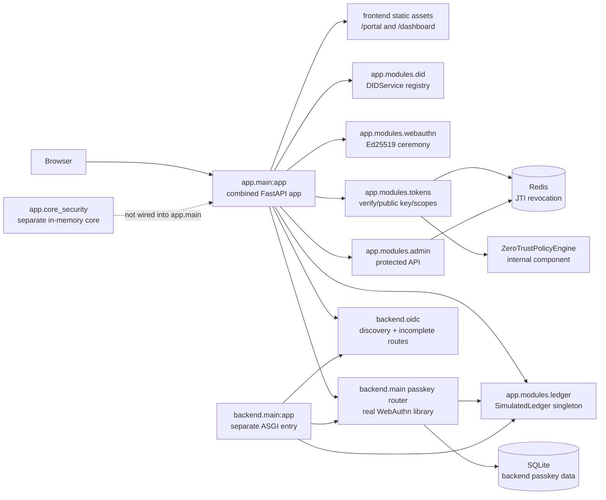
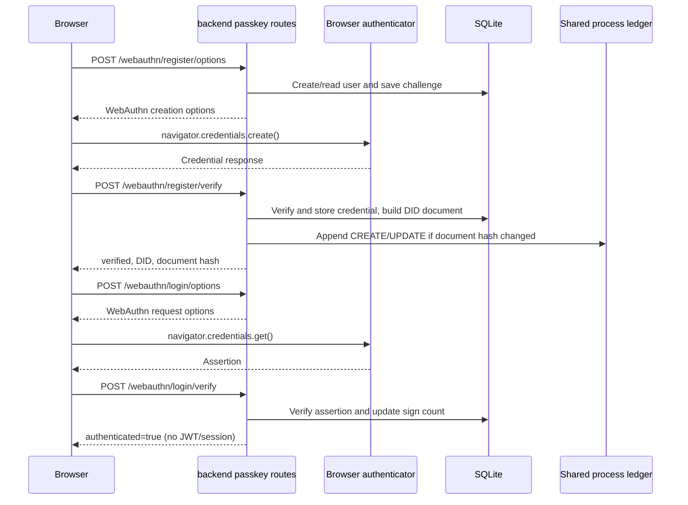
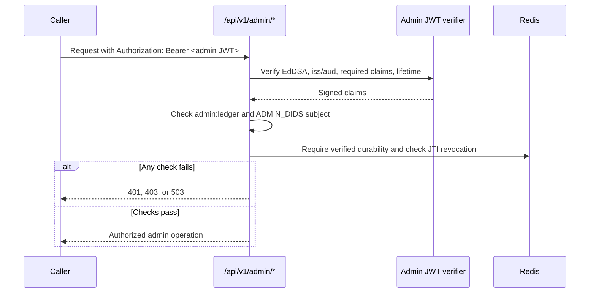

# TrustMesh architecture

This document describes the code currently mounted by `app.main:app`, plus the separately importable core-security and backend surfaces. It distinguishes live components from code that is incomplete or disconnected. The ledger described here is a **single-process, simulated hash-linked log**; there is no peer network, replication protocol, or consensus mechanism.

## System boundaries



### Main application wiring

`app.main:app` loads dotenv configuration, configures CORS, wires a shared `SimulatedLedger` into the DID, simulated-WebAuthn, token-policy, and admin module singletons, then mounts their routers under `/api/v1`. It also mounts the browser passkey router and OIDC router at their unversioned paths, serves the portal and dashboard static files, and exposes root and composite health routes.

`backend.main:app` is a different FastAPI application. It contains the browser WebAuthn routes, an unversioned ledger router, its own static asset routes and health route, and OIDC. It is not the entry point for the combined token/DID/admin API. The primary app imports and mounts only the backend passkey router and initialization function (plus OIDC), not the separate backend FastAPI app itself.

The `app.core_security` package is a separate process-local DID/challenge/ledger core with tests under `core_security_tests/`. The current `app.main` router wiring does not use it.

## Data ownership and persistence

| State | Active implementation | Persistence and boundary |
|---|---|---|
| DID documents for `/api/v1/did` | `DIDService` dictionary in `app/modules/identity/did_service.py` | Process-local; lost on restart. |
| DID mutation challenges | `ChallengeStore` instances | Process-local, single-use, short-lived; not shared across workers. |
| Credentials for `/api/v1/webauthn` | `CredentialStore` | Process-local; bound to the DID module's Ed25519 keys. |
| Browser passkey users/credentials/challenges/DID docs | Helpers in `backend/main.py` | SQLite at `WEBAUTHN_DB_PATH` (default `backend/webauthn.sqlite3`). This is separate from the module stores above. |
| Application ledger | `ledger_instance` in `app/modules/ledger/router.py` | In-memory singleton by default. `SimulatedLedger` supports optional JSON load/save if a caller supplies a path, but `app.main` does not configure one. |
| Revoked JWT IDs | `TokenRevocationStore` | Redis by default (`REDIS_URL`); bounded process-local fallback only with explicit development settings. Admin authorization requires Redis durability checks and never accepts the memory backend. |
| OIDC authorization codes | Helpers in `backend/oidc/service.py` | The helper names a separate SQLite file and implements code/PKCE functions, but route handlers do not connect a complete exchange. |

`backend/storage.py` and `backend/webauthn_service.py` are another helper/service path; `backend.main` defines and uses its own SQLite helpers rather than importing that service. Do not treat similarly named modules or stores as interchangeable.

## DID identity and registration

The `/api/v1/did` path generates Ed25519 keys, derives a DID of the form `did:mesh:key:<16 hex characters>`, constructs a DID document, and stores it in the in-memory registry. With `anchor_to_ledger=true` (default), it appends a `CREATE` ledger record. The API returns the private seed once; the server does not retain it.

Updates and deactivation use short-lived, one-use DID-controller challenges bound to the operation and exact change set. The controller signs a canonical, domain-separated message with the currently registered Ed25519 key. After successful proof and ledger append, the in-memory DID document changes. DID mutation challenges are also process-local.

The browser passkey API uses a different identifier scheme: it derives a stable `did:mesh:<32 hex characters>` from a SQLite user handle, writes its DID document to SQLite, and appends a ledger record when its document hash changes. That flow is not the `/api/v1/did` DID registry; it does not populate that in-memory registry. Consequently, the two identifiers and documents are not automatically resolvable through one another.

## WebAuthn and passkey behavior

Two independent authentication implementations are mounted:

1. **`/api/v1/webauthn/*` simulated ceremony:** creates a random challenge in memory and verifies Ed25519 signatures over a ceremony-specific message. Credentials are in an in-memory store. It is challenge-response code, not a browser's standard WebAuthn attestation/assertion protocol.
2. **`/webauthn/*` browser passkey flow:** the portal calls the `webauthn` Python library and browser `navigator.credentials` APIs. User, credential, challenge, and DID document records are stored in SQLite. This path verifies actual WebAuthn registration and authentication responses.

The browser login verification response is `{ "authenticated": true, "username": "...", "message": "..." }`. It does not create an application JWT, an admin JWT, a cookie, or a server-side authenticated session. The simulated API response likewise does not establish a session used by token issuance.

## Cryptographic signing and JWTs

The token module loads an existing Ed25519 PEM key pair from `TOKEN_KEY_DIR`; that directory must be external to the checkout. The `jwt_engine` uses EdDSA and validates required issuer/audience/time claims. The public key and allowed-scope routes are exposed. A token issuance helper exists internally, but `POST /api/v1/tokens/issue` is deliberately disabled until there is an authenticated caller principal and authorization check.

The internal zero-trust policy component checks that a DID has a ledger record, is not deactivated according to its latest record, the overall ledger verifies, and requested scopes are allowed. It can optionally check the in-memory simulated WebAuthn credential store. This is a policy component, not caller authentication, and it is not currently invoked by the disabled HTTP issuance endpoint.

Ordinary token verification validates the signature and claims, then queries the revocation store. Invalid/expired/revoked tokens are represented by a `200` response with `valid: false`; unavailable revocation status yields `503`. The ordinary HTTP revoke route is disabled. The separate admin force-revoke route accepts a complete target token, verifies its signature and JTI, and stores a revocation entry if admin authorization and durable Redis checks succeed.

## Redis and revocation

Redis revocation uses keys prefixed `revoked_jti:` with value `1` and token-bounded expiry. Startup connection failure does not turn a storage error into “not revoked.” An in-memory backend can be enabled only by both `TRUSTMESH_ENV=development` and `TOKEN_REVOCATION_ALLOW_IN_MEMORY=true`; it is process-local, bounded, and non-durable.

Admin JWT verification additionally requires the Redis node to report AOF enabled, `appendfsync always`, a healthy AOF write status, and `maxmemory-policy noeviction`. The health response reports availability and configuration assessments. A verified configuration is not an end-to-end durability or backup guarantee.

## Admin authentication and authorization

Every `/api/v1/admin/*` route depends on `require_admin`. It expects a separately issued EdDSA bearer JWT with:

- `iss` and `aud` equal to `idp-mesh-admin`;
- a valid `sub`, `jti`, `iat`, and `exp`, with a lifetime no longer than 24 hours;
- the `admin:ledger` scope; and
- a `sub` included in `ADMIN_DIDS`.

The matching public key is configured in `ADMIN_JWT_PUBLIC_KEY`. There is no admin token issuance endpoint or connection from browser passkey login to this admin-token trust domain. Invalid/missing authentication returns 401, missing scope/allowlist returns 403, and unavailable or unverifiable durable revocation state returns 503.

Ledger tamper demos are disabled unless `ENABLE_LEDGER_TAMPER_DEMO` is explicitly enabled. Both demo handlers operate on an isolated copy and return the copy's integrity result; they do not mutate the shared ledger.

## Hash-linked ledger and integrity verification

The application ledger uses sequential records with an index, timestamp, DID, document hash, operation, previous-record hash, record hash, and metadata. SHA-256 hashes over canonical record payloads link each record to its predecessor. `verify_integrity` recomputes hashes and links. The ledger is guarded by a process-local lock and has an initial genesis record.

This makes changes detectable relative to the stored chain; it does not make the log a distributed blockchain, establish consensus, provide independent replicas, or prevent an operator from replacing the entire in-memory history. The primary singleton is not persisted across restarts. Anchor calls require a valid DID controller challenge/signature; the demo routes are admin-protected and feature-flagged.

## OIDC

The discovery handler returns static metadata and the `/authorize` route validates a subset of authorization-code/PKCE query fields before returning `501`. The `/token` route returns `501`; `/userinfo` returns `401` without a bearer header and `501` when one is present. The discovery response advertises static loopback URLs and `RS256`, which is not an implemented TrustMesh token integration. The SQLite code/PKCE helper is not wired to these endpoint handlers.

## Frontend

FastAPI serves the static portal at `/portal/` and dashboard at `/dashboard/`. The portal's `webauthn.js` talks to the unversioned backend passkey routes. The dashboard reads public ledger/token/health endpoints, derives its identity table from ledger records, and does not call protected admin routes or send a bearer token. Its API base is `/api/v1` on port 8000 and otherwise hard-coded to `http://localhost:8000/api/v1`. Its tamper UI request cannot complete the admin-protected flow as currently wired.

There is no event-store API; the dashboard correctly shows that events are unavailable rather than generating mock events.

## Supported flow diagrams

### DID registration and ledger anchor

```mermaid
sequenceDiagram
    participant Client
    participant DID as /api/v1/did
    participant Registry as In-process DIDService
    participant Ledger as SimulatedLedger
    Client->>DID: POST /create (anchor_to_ledger=true)
    DID->>DID: Generate Ed25519 key pair
    DID->>Registry: Register DID document
    DID->>Ledger: Append CREATE with document hash
    DID-->>Client: DID, document, public key, one-time private key, record index
    Note over Registry,Ledger: Registry and ledger are process-local; this does not replicate the identity.
```

### Browser passkey registration and login



### Token verification and revocation

```mermaid
sequenceDiagram
    participant Caller
    participant Verify as POST /api/v1/tokens/verify
    participant JWT as EdDSA verifier
    participant Redis as Revocation store
    Caller->>Verify: JSON token
    Verify->>JWT: Verify signature, issuer, audience, required claims, expiry
    alt JWT invalid or expired
        JWT-->>Verify: validation failure
        Verify-->>Caller: 200 {valid:false, error:...}
    else JWT valid
        JWT-->>Verify: verified claims and jti
        Verify->>Redis: Check revoked_jti:<jti>
        alt JTI revoked
            Redis-->>Verify: revoked
            Verify-->>Caller: 200 {valid:false, error:...}
        else Redis check succeeds and not revoked
            Redis-->>Verify: not revoked
            Verify-->>Caller: 200 {valid:true, claims:...}
        else revocation state unavailable
            Redis-->>Verify: unavailable
            Verify-->>Caller: 503
        end
    end
    Note over Caller,Redis: Ordinary HTTP issuance and revoke handlers return 503; admin force-revoke is separate.
```

### Admin authorization



### Ledger append and integrity verification

```mermaid
sequenceDiagram
    participant Controller
    participant API as /api/v1/ledger
    participant DID as In-process DID registry
    participant Challenges as In-memory challenge store
    participant Ledger as SimulatedLedger
    Controller->>API: POST /anchor/challenge (DID, doc_hash, operation)
    API->>DID: Resolve active DID controller key
    API->>Challenges: Issue one-use, short-lived challenge
    API-->>Controller: challenge
    Controller->>Controller: Sign canonical anchor message with DID key
    Controller->>API: POST /anchor (fields + challenge + signature)
    API->>Challenges: Consume challenge
    API->>DID: Resolve active controller public key
    API->>API: Verify Ed25519 ownership proof
    API->>Ledger: Append hash-linked record
    API-->>Controller: New LedgerRecord
    Controller->>API: GET /verify
    API->>Ledger: Recompute hashes and predecessor links
    API-->>Controller: valid, error, count, head hash
    Note over Ledger: One process-local chain; no peers or consensus.
```

## Architectural limitations

- The separate registry and credential stores prevent a single end-to-end DID → browser passkey → authenticated session → JWT flow.
- Most identity/challenge/ledger state is process-local and is not safe for multi-worker or restart continuity.
- The browser passkey database and the simulated module stores can disagree.
- The dashboard is a read-only public-data view, not an authenticated admin console.
- OIDC and security-event persistence are incomplete; distributed ledger semantics are not implemented.
